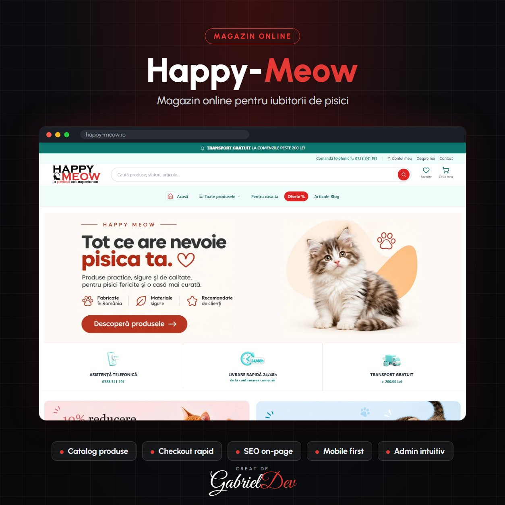

  

<h1 align="center">Magazin online Happy-Meow.ro</h1>

Magazin online modern dedicat iubitorilor de pisici, dezvoltat pentru o experiență de cumpărare rapidă și intuitivă. Platforma oferă produse premium pentru pisici, design responsive și performanță optimizată.

| | |
|---|---|
| **Client** | Happy-Meow |
| **An** | 2026 |
| **Domeniu** | Backend Development · Frontend Development · Magazin online |
| **Status** | Live — [happy-meow.ro](https://happy-meow.ro) |
| **Studiu de caz** | [gabrieldev.eu](https://gabrieldev.eu/portofoliu/magazin-online-happy-meowro) |

---

## Creare magazin online Happy-Meow.ro

Happy-Meow.ro este un proiect de **creare magazin online** realizat de GabrielDev pentru un business dedicat produselor premium pentru pisici. Platforma a fost dezvoltată pentru a oferi o experiență rapidă, intuitivă și optimizată pentru conversii, fiind construită conform celor mai bune practici de dezvoltare web și SEO.

## Dezvoltare magazin online personalizat

Acest proiect reprezintă un exemplu de **dezvoltare magazin online personalizat**, realizat cu accent pe performanță, optimizare SEO, experiență Mobile First și încărcare rapidă. Magazinul este optimizat pentru Google și oferă o structură modernă, ușor de administrat și scalabilă.

## Funcționalități implementate

- Creare magazin online complet personalizat
- Design modern și responsive
- Optimizare SEO On-Page
- Experiență Mobile First
- Catalog produse și categorii optimizate
- Checkout rapid și intuitiv
- Performanță ridicată și încărcare rapidă
- Structură optimizată pentru indexarea în Google
- Interfață de administrare ușor de utilizat

## De ce acest proiect?

Happy-Meow.ro demonstrează experiența GabrielDev în **crearea magazinelor online** moderne și optimizate pentru motoarele de căutare. Fiecare proiect este dezvoltat cu accent pe performanță, experiența utilizatorului și rezultate în Google, indiferent dacă este vorba despre un magazin online de nișă, un marketplace sau o platformă eCommerce complexă.

## Servicii oferite

Dacă ai nevoie de **creare magazin online**, **dezvoltare magazin online personalizat**, optimizare SEO sau implementarea unei platforme eCommerce performante, acest proiect reprezintă un exemplu al calității și atenției la detalii oferite de GabrielDev.

---

## 🔒 Despre cod

Acesta este un repository de **prezentare**. Codul sursă aparține clientului și nu este public — aici găsești descrierea proiectului, funcționalitățile și tehnologiile folosite.

## 🤝 Ai nevoie de ceva asemănător?

Proiect realizat de **[Gabriel Dev](https://gabrieldev.eu)** — creare site-uri, magazine online și aplicații web personalizate.

- 🌐 [gabrieldev.eu](https://gabrieldev.eu) · [toate proiectele](https://gabrieldev.eu/proiecte)
- ✉️ [contact@gabrieldev.eu](mailto:contact@gabrieldev.eu)
- 📞 [+40 743 543 100](tel:+40743543100)
